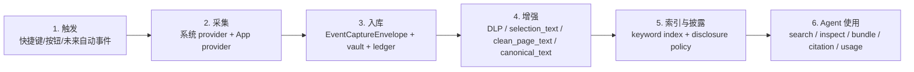

# WorkRecorder RFC：主动式上下文事件层

状态：当前实现对齐版
日期：2026-05-18

## 一句话

WorkRecorder 让用户用一次主动截图，把“我刚刚看到的工作现场”变成 Agent 可安全搜索、精查、引用和复盘的上下文事件。

## 背景

Agent 经常缺真实上下文。用户明明刚看过一个网页、表格、聊天、错误页面或文档，但要让 Agent 帮忙时，仍然需要复制粘贴、解释背景、找链接、描述截图。信息散在浏览器、桌面 App、聊天工具、CRM、IDE、PDF 和文档里，模型不知道，也不能凭空猜。

WorkRecorder 的判断是：不要做“截图仓库”，要做“上下文事件层”。

```text
截图工具：截图 -> 存图 -> OCR -> 搜图
WorkRecorder：用户触发 -> 采集系统和 App 证据 -> 生成可审计事件 -> Agent 渐进式读取
```

截图只是证据之一。真正的主对象是一次 `Context Event`。

## 产品原则

1. **用户主动触发**：第一版不做默认 24/7 录屏。
2. **本地优先**：raw screenshot、full DOM、a11y tree 默认存在本机 vault。
3. **事实和增强分层**：provider 采到的是事实层；DLP、canonical text、clean page text、summary、index 是增强层。
4. **默认最小披露**：Agent 粗搜只拿安全摘要卡。
5. **精查必须带 event_id**：Agent 要看更完整文本或 screenshot ref，必须明确指定事件。
6. **危险原料默认不可读**：raw DOM、raw a11y tree、provider raw diagnostics 不默认给 Agent。
7. **全程留痕**：Agent 搜索、精查、bundle、citation、usage 都写入本地 run ledger。
8. **provider 可插拔**：Web 是第一个 adapter；未来其他 App 按 manifest + adapter + tests 接入。

## 当前实现范围

当前主线支持：

- macOS 快捷键选区截图 shell。
- daemon 做 surface detection、provider routing、provider command、artifact persistence、enrichment、audit、index。
- Chrome/Edge extension 作为 Web provider。
- macOS a11y provider 作为系统 evidence provider。
- `selection_text`：从 a11y blocks 生成截图框内文本，默认展示给 Agent。
- `clean_page_text`：从 Web readability/live DOM 生成 Agent 可读网页正文。
- `canonical_text`：daemon 派生的可索引文本。
- Disclosure Policy SDK：统一决定 summary、inspect、bundle、raw endpoint 能看到什么。
- Pluggable Index：v1 是 SQLite keyword + FTS/ngram fallback。
- Agent Run Ledger：记录一次 Agent 回答搜了什么、看了什么、引用了什么。
- `workrecorder` CLI + `workrecorder-context` skill。

## 六阶段主链路



## Agent 读取模型

WorkRecorder 面向 Agent 的读取不是“一次把所有数据倒出去”，而是渐进式披露。

粗搜默认给：

- app 名称
- 页面 title
- origin / 去掉 query/hash 的 URL
- 截图时间
- 截图框内文本 `selection_text`
- 用户主动 note
- `event_id`
- hidden artifacts 清单

带 `event_id` 精查可给：

- `selection_text`
- DLP/redaction 后的 `canonical_text`
- 清洗后的 `clean_page_text`
- raw screenshot 的引用
- evidence refs / artifact metadata

默认不给：

- raw full DOM
- raw a11y tree
- vault path
- URL query/hash
- cookies、localStorage、sessionStorage、network response
- password / hidden secret raw value

## 为什么要这么设计

因为 WorkRecorder 的目标不是“多采一点”，而是让 Agent 拿到的上下文可信、可控、可复盘。

- 可信：每条 evidence 知道来自哪个 provider、哪个 command、哪个 artifact。
- 可控：读的时候由 disclosure policy 决定能看什么。
- 可复盘：Agent run 记录 query、返回字段、citation、usage。
- 可扩展：新增 App provider 不需要改主链路，只实现 provider manifest 和 adapter。

## 不在当前阶段做什么

- 不做全量后台录屏。
- 不默认 OCR 所有屏幕内容。
- 不默认上传 raw artifact 到云端。
- 不直接给 Agent raw DOM/a11y tree。
- 不把 Gmail/Slack/CRM/IDE 等 provider 写死进 daemon。
- 不让 CLI/skill import 主仓库内部模块；它们只走 daemon API。

## 文档

完整中文文档入口见 [docs/README.md](docs/README.md)。
