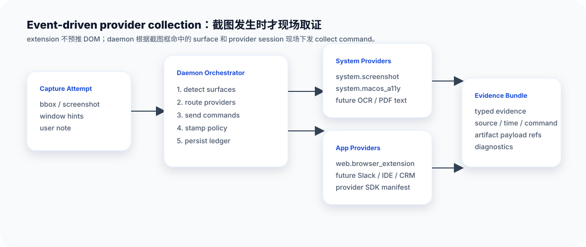

# 阶段 2：采集

> 导航：[返回文档总览](README.md) · 上一篇：[阶段 1：触发](01_TRIGGER_CN.md) · 下一篇：[阶段 3：事件入库](03_EVENT_LEDGER_CN.md)

采集阶段回答两个问题：

> 这个截图框命中了哪些 App、窗口或页面？
> 应该叫哪些 provider 在这一刻现场取证？

WorkRecorder 的采集不是“每个 App 一直轮询并上传数据”。它是 event-driven：只有用户触发截图后，daemon 才根据命中的 surface 下发采集命令。

P4 之后，这里有一个很重要的产品原则：

> **截图先保存，App provider 只是增强。**

也就是说，只要系统侧已经拿到合法截图，这次 capture 就会生成一条 accepted event。Chrome、PDF、Slack、飞书、IDE 等 App provider 能补多少就补多少；补不上也不会让这张截图消失。provider 的成功、失败、跳过、超时都会进入同一个案卷。

## Surface detection：先知道框中了什么

用户框选的是屏幕坐标，但 provider 关心的是 App 和内容表面。所以 daemon 首先要做 surface detection。

它会综合：

- macOS window hints。
- bbox 和窗口的 overlap。
- display / coordinate space。
- App name、bundle id、pid、window id。
- provider session 信息。
- 置信度和 freshness。

输出是一组 detected surfaces。每个 surface 会记录：

- 是什么 App。
- 哪个窗口。
- bbox 与窗口重叠比例。
- 是否像 Web 页面、PDF、原生窗口等。
- 置信度。
- 诊断信息。

这一步很关键，因为它决定后面叫谁采。

## 两类 provider

### 系统 provider

系统 provider 不属于某个 App。它提供跨 App 都有价值的公共证据。

当前系统 provider 包括：

- `system.screenshot`：OS 截图。
- `system.macos_a11y`：macOS Accessibility tree、text blocks、coverage。
- `system.appshot`：把截图、窗口/App 事实、a11y/OCR 状态、权限和质量诊断串成一份只读系统底片。

系统 provider 的价值是“通用”。网页、PDF、原生 App、聊天窗口、表格软件，都可能通过 a11y 得到框内文字或 UI 结构。

P5 之后，系统 provider 也走和 App provider 一样的 bundle / outcome / ledger 模型。`system.appshot` 不复制 raw screenshot 或 raw a11y tree，它只保存安全引用和质量报告，用来解释“这次截图当时系统侧到底知道了什么”。详细设计见 [System Appshot：只读系统底片](architecture/SYSTEM_APPSHOT_CN.md)。

### App provider

App provider 了解某个 App 的内部结构。它能采系统层拿不到的内容。

Chrome/Edge Web provider 当前能采：

- URL、origin、title。
- viewport、scroll、DPR、zoom。
- selected text。
- visible text。
- full DOM。
- readability / page text source。
- selection map。
- iframe、shadow DOM、PDF-like coverage diagnostics。

这些信息系统截图和 a11y 不一定能准确得到，所以 Web provider 是 Chrome 的专属增强。

## 为什么要 event-driven

早期过渡方案里，extension 可以短 TTL 注册 context。成熟版不应该这么走。

成熟版是：

1. extension 连接 daemon，只声明“我在线、我有什么能力”。
2. 用户截图。
3. daemon 判断 bbox 命中了 Chrome。
4. daemon 通过 WebSocket 下发 `CollectEvidenceCommand`。
5. extension 对当前真实 tab 现场读取 DOM、文本、viewport。
6. daemon 收到 typed evidence bundle。

这样有几个好处：

- 不让 App provider 背景轮询。
- 不提前采集用户没触发的内容。
- 采集时间和用户截图时间对齐。
- daemon 能记录每个 command 的开始、结束、超时、失败。
- 多 provider 可以在同一次 capture 里统一编排。

## Router 怎么选 provider

ProviderRoutingService 不按 `if app == Chrome` 这种写死分支工作。它根据 provider manifest 和策略做选择。

选择因素包括：

- provider capabilities 是否匹配 surface。
- provider session 是否 fresh。
- surface overlap 和 confidence。
- workspace/app policy 是否允许。
- provider deadline 和优先级。
- 是否是系统默认 provider。

这里现在有一层单独的 `ProviderRoutePolicy`。它专门回答两个问题：

- **谁是主来源**：默认按 bbox overlap 和 surface detection confidence 打分。用户框住最多、最可信的窗口是 primary source。provider 是否在线不会改变“主 App 是谁”。
- **哪些是附属来源**：其他窗口只有超过可配置 overlap 阈值才会触发 App provider；同时有最大 fanout 数量，避免一个大框把一堆无关窗口都叫起来。

所以如果用户框到了 Preview/PDF 为主，但旁边压到一点 Chrome，事件主来源仍然是 Preview/PDF；Chrome provider 成功时只作为 secondary source 补充网页材料。反过来，如果主区域是 Chrome，Chrome 才是主来源。

这层策略不是写死在代码里的常量。daemon settings 里可以调整最低 provider 置信度、附属来源最小 overlap、最多 fanout 几个 App、confidence/overlap 权重。后续 workspace 或 provider profile 也可以复用同一套配置入口，而不是在 router 里加一堆 `if app == ...`。

一次截图可以路由到 0..N 个 provider：

- 系统 provider 每次都尝试运行，`system.screenshot` 必有。
- `system.appshot` 每次生成系统底片，记录主 App、附属 surface、权限和质量状态。
- Web surface 命中时运行 Web provider。
- 多个 App 同时命中时可都采集，route policy 选出的最高分 surface 是 primary source，其他合格 surface 是 secondary sources。
- 低置信度、未支持、provider 离线、超时都会写 diagnostics。
- 没有任何 App provider 命中时，也会保存为 system-only event，后续可以靠 a11y/OCR/用户 note 搜到。
- 如果用户只框到了桌面背景，没有命中任何 App 窗口，会显式保存为“桌面区域”，而不是报“只支持网页”。

## Provider 返回什么

Provider 不返回“我要给 Agent 看什么”。它只返回自己采到的 evidence bundle。

例如 Chrome provider 返回：

- page metadata。
- full DOM。
- visible text。
- readable page text source。
- selection map。
- viewport metadata。

它可以声明 sensitivity 或 redaction claim，但最终是否可读、是否可索引、是否进入 bundle，由 daemon 的 policy 决定。

## 设计亮点

- **daemon 统一编排**：所有 provider 都被同一套命令和审计模型调度。
- **系统/App 解耦**：公共能力在系统 provider，App 深度能力在 App provider。
- **新 provider 易接入**：manifest + adapter + tests，不改主链路。
- **失败可复盘**：provider 超时、拒绝、低置信度不是沉默失败，都会落 diagnostics。
- **隐私更稳**：不轮询、不预推，只在用户触发时采集。

## system-only 和 enhanced 的区别

一次截图最终大概会落成三类状态：

| 状态 | 含义 |
| --- | --- |
| system-only / 已保存 | 有系统截图、窗口信息，a11y/OCR 会尝试补文字；没有 App 深度增强 |
| enhanced / 已增强 | 至少一个 App provider 成功，比如 Chrome 补到了 URL、网页正文、DOM |
| partial / 部分增强 | event 已保存，但某些 provider 失败、离线、超时或跳过 |

这比“Web provider 不在线就 unsupported”更符合本机上下文产品：用户框选的内容不会因为某个增强源掉线而丢掉。

## 当前边界

第一版重点跑通系统优先 + Web 增强：

- Chrome 和 Edge 是主要目标。
- Arc 只有在窗口/session 匹配可靠后再打开。
- Safari/Firefox 需要对应 provider 或可靠注册后再做深度增强。
- 非 Web App 默认保存 system-only event，依赖截图、a11y、OCR 和用户 note；后续可以逐个接 App provider。
- PDF/文档第一版先走 system-only + OCR/a11y，真正 PDF provider 后续接入同一套路由和 bundle 机制。

---

导航：[返回文档总览](README.md) · 上一篇：[阶段 1：触发](01_TRIGGER_CN.md) · 下一篇：[阶段 3：事件入库](03_EVENT_LEDGER_CN.md)
