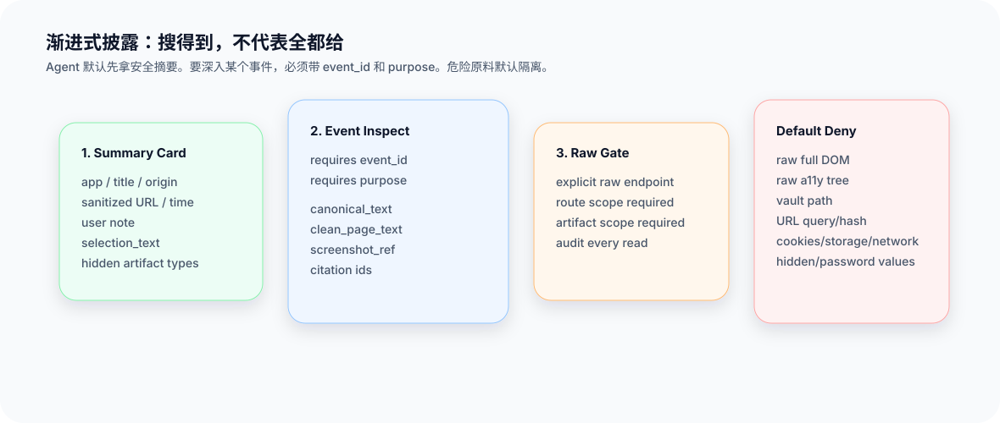

# 阶段 5：索引与披露

> 导航：[返回文档总览](README.md) · 上一篇：[阶段 4：增强与去噪](04_ENRICHMENT_CN.md) · 下一篇：[阶段 6：Agent 使用与复盘](06_AGENT_USAGE_CN.md)

这一阶段回答两个容易混在一起的问题：

> Agent 怎么搜得到相关上下文？
> 搜到了以后，Agent 能看到哪些字段？

这两个问题必须分开。能被召回，不等于可以把所有原料都交给 Agent。

## Index layer：负责搜得到

WorkRecorder 有独立的 `packages/indexing`。它不属于 CLI，也不属于 provider，更不应该散落在 bundle 或 ledger 代码里。

index layer 负责：

- 接收 daemon 派生的安全文本 projection。
- 写入 index backend。
- 执行搜索、召回、排序、解释。
- 支持过滤和游标。
- 记录 index receipt。
- 删除事件时清理 index。
- 未来切换 backend。

第一版 backend 是 SQLite keyword：

- FTS5 可用时用 FTS5。
- 中文/英文混合文本用 ngram 辅助召回。
- FTS5 不可用时 fallback 到 escaped LIKE。
- backend 接口固定，未来可插 embedding、graph、visual index。

## 哪些内容能进 index

能进 agent-facing index 的只应该是 daemon 派生并经过策略允许的 projection。

当前允许：

- user note。
- `selection_text`。
- `canonical_text`。
- `clean_page_text`。
- safe metadata：title、origin、app、workspace、captured_at。

不允许：

- raw screenshot。
- raw full DOM。
- raw a11y tree。
- provider raw diagnostics。
- vault path。
- URL query/hash。
- cookies、storage、network response。

这条线非常重要：索引不是保险箱。只要进入 agent-facing index，就有机会被搜索命中，所以必须先做 DLP/redaction 和 policy stamp。

## Search API：返回安全摘要卡

`/v1/search` 默认不返回裸 event，也不返回完整 evidence。它返回 DisclosurePolicyService 构建的 `SearchResultCard`。

一张卡通常包含：

- event_id。
- captured_at。
- app name。
- title。
- origin。
- sanitized URL。
- workspace。
- user note。
- selection bbox。
- selection_text snippet 或完整 selection_text。
- hidden artifacts 清单。
- preview citation id。
- index explain（可选）。

这让 Agent 粗搜时能快速判断“这条上下文是不是相关”，但不会顺手拿到 raw DOM、raw a11y tree 或 raw screenshot。

## Disclosure Policy：负责能看多少

DisclosurePolicyService 是读取时的统一裁剪层。它根据 actor、purpose、view、event、evidence、artifact、workspace profile 生成 allow/deny 决策。

常见视图：

| 视图 | 场景 | 可以返回什么 |
| --- | --- | --- |
| `summary_card` | 粗搜 | app、title、origin、时间、note、selection_text、hidden artifacts |
| `event_inspect` | 带 event_id 精查 | selection_text、canonical_text、clean_page_text、screenshot ref、evidence refs |
| `bundle_item` | 打包给 Agent | 可引用的 canonical chunks 和 citation refs |
| `artifact_preview` | 看 artifact 元数据 | type、role、hash、size、policy，不给 raw bytes |
| `raw_artifact` | 显式 raw 读取 | 需要 scope、purpose、审计，默认只开放有限 raw screenshot |
| `debug_manifest` | 开发诊断 | provenance 和 diagnostics，不给 raw content |

## Chrome disclosure profile

Chrome 默认粗搜直接给：

- app：Google Chrome。
- 页面 title。
- origin。
- 去掉 query/hash 的 URL。
- 截图时间。
- 截图 bbox。
- user note。
- `selection_text`。
- event_id。
- hidden artifacts 清单，例如 `full_dom`、`screenshot`、`a11y_tree`。

带 event_id 精查可以给：

- 完整 `selection_text`。
- `canonical_text`。
- `clean_page_text`。
- raw screenshot ref。
- evidence refs。
- artifact metadata。
- citation ids。

默认不给：

- raw full DOM HTML。
- raw a11y tree。
- provider diagnostics raw payload。
- cookie、localStorage、sessionStorage、IndexedDB。
- network request/response。
- password/hidden secret/form raw value。
- URL query/hash。
- vault path。

## workspace override 怎么用

不同团队可能有不同读取策略。比如有的 workspace 希望默认卡里的 selection_text 最多 800 字，有的希望 3000 字；有的希望 screenshot raw 永远拒绝。

WorkRecorder 支持 workspace override，但它不能绕过 hard deny。

也就是说：

- 可以调低展示上限。
- 可以隐藏更多字段。
- 可以让某些 provider 的精查更严格。
- 不可以把 raw full DOM 直接开放给 Agent。
- 不可以让 provider 自己升级权限。

## CLI 和 skill 的边界

Agent 使用的是 `workrecorder-context` skill。skill 只写使用说明和推荐 workflow。

实际命令由 `workrecorder` CLI 执行。CLI 也不 import daemon 内部模块，只调用 daemon HTTP API。

这样做的好处是：

- skill 可以独立发布和安装。
- CLI 是稳定本地客户端。
- daemon 是唯一策略和审计入口。
- Agent 不能通过 import 内部 Python 绕过 disclosure。

## 设计亮点

- **搜索和披露解耦**：召回相关 event，不等于暴露所有内容。
- **默认安全卡**：粗搜足够判断相关性，但不会泄漏 raw 原料。
- **精查有边界**：带 event_id 才能看更完整文本。
- **raw 有闸门**：raw artifact 必须走单独 endpoint 和审计。
- **索引可插拔**：未来换向量库或图索引不影响 agent-facing CLI。

---

导航：[返回文档总览](README.md) · 上一篇：[阶段 4：增强与去噪](04_ENRICHMENT_CN.md) · 下一篇：[阶段 6：Agent 使用与复盘](06_AGENT_USAGE_CN.md)
