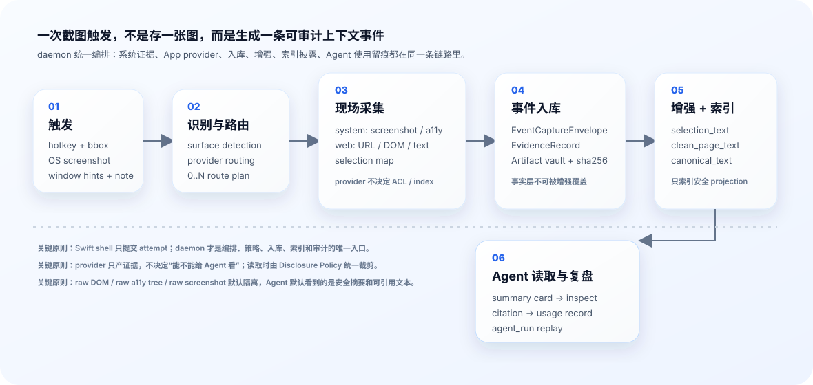

# 总体技术简介

WorkRecorder 想解决的问题不是“把屏幕截个图存起来”。它真正要做的是：

> 当用户在电脑上看到一段有价值的信息时，用一次主动截图，把当时的工作现场变成 Agent 以后可以安全读取、可以追溯来源、可以复盘使用过程的上下文事件。

这件事看起来像截图，背后其实是一个本机上下文基础设施：它要知道用户框了哪里、当时是哪一个 App、哪些系统能力能补全信息、哪些 App provider 能现场采集、哪些原始材料太敏感、哪些文本可以给 Agent 搜、Agent 最后到底看了什么。

## 一句话理解

可以把 WorkRecorder 想成一套“本机上下文案卷系统”。

用户按快捷键框住屏幕上的一块内容，WorkRecorder 会生成一份案卷。这份案卷里有当时的截图、窗口、网页、系统可访问文本、清洗后的正文、搜索索引、引用线索和审计记录。Agent 以后不是凭印象回答，而是先搜案卷，再按权限读取，再用 citation 引用证据。

## 为什么不是普通剪藏工具

普通剪藏工具通常保存的是“页面”或“截图”。WorkRecorder 关注的是“用户当时主动指向的上下文”。

这里有几个重要差别：

| 普通截图/剪藏 | WorkRecorder |
| --- | --- |
| 存一张图片或网页 | 存一次可审计的上下文采集运行 |
| 只知道内容，不知道采集链路 | 记录 trigger、surface、provider、artifact、enrichment、index、usage |
| 搜索经常直接搜原文 | 只索引经过策略允许的安全文本 projection |
| Agent 读到什么不一定可复盘 | 每次 search、inspect、bundle、citation 都留痕 |
| 新 App 接入容易变成特例 | 新 provider 通过 manifest + adapter + disclosure profile 接入 |

这个设计的目标是：Agent 用得上，人也查得清。

## 六阶段设计

WorkRecorder 把截图后的链路拆成六个阶段。每个阶段只做一类事情，避免把所有逻辑塞进一个“保存事件”的大函数里。

| 阶段 | 文档 | 这一阶段回答的问题 | 关键输出 |
| --- | --- | --- | --- |
| 1. 触发 | [阶段 1：触发](01_TRIGGER_CN.md) | 用户刚才想记录什么？ | capture attempt、bbox、note、window hints、staged screenshot |
| 2. 采集 | [阶段 2：采集](02_COLLECTION_CN.md) | 这个 bbox 命中了什么？该叫哪些 provider？ | detected surfaces、route plan、provider command results |
| 3. 入库 | [阶段 3：事件入库](03_EVENT_LEDGER_CN.md) | 采集结果如何成为可审计案卷？ | ContextEvent、EventCaptureEnvelope、EvidenceRecord、Artifact |
| 4. 增强 | [阶段 4：增强与去噪](04_ENRICHMENT_CN.md) | 原始材料如何变成安全可读文本？ | selection_text、clean_page_text、canonical_text |
| 5. 索引与披露 | [阶段 5：索引与披露](05_INDEX_DISCLOSURE_CN.md) | Agent 怎么搜？搜到后能看多少？ | SearchResultCard、EventInspectView、index receipts、disclosure audit |
| 6. Agent 使用 | [阶段 6：Agent 使用与复盘](06_AGENT_USAGE_CN.md) | Agent 为了回答问题到底看了什么？ | agent run、retrieval snapshots、citations、usage event |

这六步是产品故事线，也是代码分层的边界。前面越靠近用户和系统现场，越强调快和准确；后面越靠近 Agent，越强调安全、裁剪、引用和审计。

## 核心设计思想

### 1. 用户主动框选是第一信号

WorkRecorder 不想默认扫完整桌面，也不想让每个 App 一直把内容推给后台。用户按快捷键、拖出一个 bbox，这个动作本身就是明确的意图：这里有上下文价值。

所以 macOS 侧只做薄薄一层：

- 捕获快捷键。
- 让用户选择区域。
- 截一张系统截图。
- 记录窗口 hint 和用户 note。
- 把 capture attempt 交给 daemon。

它不读 DOM，不判断事件类型，不决定 Agent 能看什么。真正的编排在 daemon。

P4 之后，保存链路也遵循 system-first：macOS shell 提交的系统截图不是“等 Web 成功后再保存”的临时材料，而是一次 capture event 的基础证据。Web、PDF、聊天、IDE provider 都只是按命中 surface 追加增强。

### 2. daemon 是唯一编排者

daemon 负责判断“这次截图应该怎么采集”。它会根据 bbox、窗口、App、provider session、策略和置信度决定要叫哪些 provider。

这个设计比 provider 自己轮询成熟得多：

- Chrome extension 不需要一直上传 DOM。
- a11y provider 不需要后台无目的扫描。
- 新 App provider 只要保持 session 和能力注册，等 daemon 下命令即可。
- 一次截图可以同时触发系统 provider 和多个 App provider。
- 某个 App provider 掉线或失败时，截图仍然保存，失败原因进入 provider outcome。
- 主来源由 route policy 按 bbox overlap 和 surface confidence 选择；App provider 是否在线只影响增强，不改变用户实际框住的主 App。
- 只框到桌面背景时也会保存为“桌面区域” system-only event。

换句话说，provider 是工具，daemon 是调度者。

### 3. 事实层和增强层分开

Provider 现场采到的是事实层，比如：

- OS screenshot。
- a11y tree。
- a11y text blocks。
- Web full DOM。
- Web visible text。
- Web page metadata。
- selection map。
- provider outcome：谁成功、谁失败、谁跳过、谁超时。

daemon 后处理出来的是增强层，比如：

- `selection_text`：截图框内文字，默认摘要卡可见。
- `clean_page_text`：清洗后的网页正文，精查时可读。
- `canonical_text`：用于搜索、bundle、citation 的统一文本。

事实层尽量不改，增强层可以重算。这让系统以后可以升级 selection_text 算法、DLP 规则、readability 提取器、OCR provider，而不用推翻原始案卷。

### 4. 存得下不代表给得出

WorkRecorder 会保存一些高敏感原料，但这不代表 Agent 默认能读。

比如 Chrome case 里：

- full DOM 默认存本地 vault，但不默认披露。
- raw a11y tree 默认不披露。
- screenshot 默认只给 ref，raw bytes 需要显式 raw endpoint 和审计。
- URL 会去掉 query/hash 后再给 Agent。
- selection_text 可以默认给，因为它是用户框内文本，并经过策略控制。

所以系统里有两层安全：

- 入库时的 Evidence Policy：给 artifact 打 sensitivity、trust、scope、indexable 等盖章。
- 读取时的 Disclosure Policy：根据视图和目的裁剪字段。

### 5. 索引是插件，不是业务逻辑

搜索并不直接扫 ledger，也不应该散落在 CLI、bundle、retrieval 里。WorkRecorder 有独立 index layer。

第一版是 SQLite keyword backend：

- 能索引 user note、selection_text、canonical_text、clean_page_text、安全 metadata。
- 支持时间、workspace、app、domain、provider、evidence kind 等过滤。
- FTS5 可用时用 FTS5；中文/混合文本有 ngram 辅助；不可用时退到 LIKE。

以后可以接 embedding、graph、visual index，但 search CLI 和 daemon API 不需要重写。

### 6. Agent 读上下文也要留痕

Agent 不是“自由读取数据库”。它通过 `workrecorder-context` skill 调 `workrecorder` CLI，CLI 再调 daemon API。每次读取都会形成 trace：

- 搜了什么 query。
- 命中了哪些 event。
- 精查了哪些 event。
- 实际返回给 Agent 哪些字段。
- 哪些 citation 被生成。
- 最终 usage record 使用了哪些 citation。

这让“Agent 为什么这么回答”可以复盘，不需要猜。

## 关键对象怎么理解

### ContextEvent

给产品层和 Agent 层使用的事件。你可以把它理解成“用户当时标记了一块上下文”。

### EventCaptureEnvelope

daemon 内部的权威案卷。它包含触发、surface detection、provider routing、command run、evidence、artifact、enrichment、index、audit 的完整结构。

它不是给 Agent 直接看的大 JSON，而是入库和复盘的骨架。

### EvidenceRecord

一条 evidence 表示“某个来源在某个时间提供了一种证据”。例如：

- `system.screenshot` 提供 screenshot evidence。
- `system.macos_a11y` 提供 a11y tree evidence。
- `system.appshot` 提供系统底片 evidence，把截图、窗口事实、a11y/OCR 状态和质量诊断串起来。
- `web.browser_extension` 提供 full DOM evidence。
- `system.enrichment.selection_text` 生成 selection_text evidence。

每条 evidence 都要能说明自己来自哪里、父证据是谁、由哪个 extractor 生成、对应哪个 artifact。

### Artifact

artifact 是实际内容或文件。它可能是一张 PNG、一段 HTML、一份 JSON、一段 Markdown、一组文本块。

WorkRecorder 用 content-addressed vault 存 artifact，并记录 sha256、字节数、content type、sidecar manifest。这样以后能验证“这是不是当时那份材料”。

### Disclosure View

Disclosure View 是 agent-facing 读取视图。常见有：

- `summary_card`：粗搜结果，默认安全摘要。
- `event_inspect`：带 event_id 精查。
- `raw_artifact`：显式 raw 读取，必须审计。
- `debug_manifest`：调试结构，不给 raw content。

### AgentRun

一次 Agent 为了回答用户问题而读取 WorkRecorder 的过程。它把 search、inspect、bundle、citation、usage 串起来。

## Web / Chrome 当前采什么

Chrome/Edge 是第一版 App provider。一次截图命中 Chrome 时，系统和 Web provider 会一起工作。

系统侧采：

- OS screenshot。
- system appshot：主 App、窗口事实、surface 列表、权限和质量状态。
- macOS a11y tree。
- a11y text blocks。
- a11y coverage report。

Chrome extension 现场采：

- app/browser/session 信息。
- URL、origin、title。
- viewport、scroll、DPR、zoom。
- selected text。
- visible text。
- full DOM。
- readability / page text source。
- selection map。
- iframe、shadow DOM、PDF-like coverage diagnostics。

daemon 派生：

- `selection_text`：尽量只含截图框内文字。
- `clean_page_text`：清洗后的完整网页正文。
- `canonical_text`：搜索和 bundle 使用的统一文本。

如果截图不是 Chrome：

- 仍然保存 OS screenshot。
- 仍然尝试 a11y。
- 仍然排队/记录 OCR job 状态。
- 搜索默认可以命中用户 note、安全 metadata，以及后续 OCR/selection_text。
- Workbench 卡片显示“已保存”，不会再误导成“只支持网页”。
- 如果同一张截图同时压到多个窗口，Workbench 卡片使用主来源 App；详情页再展示其他 provider 的附属贡献、失败或跳过原因。

## Agent 默认看什么

粗搜结果是一张安全摘要卡，而不是 event 的所有内容。

默认给：

- `event_id`
- app name，例如 Google Chrome
- 页面 title
- origin
- 去掉 query/hash 的 URL
- captured_at
- selection bbox
- 用户 note
- 完整或截断后的 `selection_text`
- hidden artifacts 清单，例如还有 screenshot/full_dom/a11y_tree 但默认不可读
- preview citation id

带 event_id 精查可以给：

- `selection_text`
- `canonical_text`
- `clean_page_text`
- screenshot ref
- evidence refs
- citation ids

默认不给：

- raw full DOM HTML
- raw a11y tree
- provider raw diagnostics
- cookies / localStorage / sessionStorage / IndexedDB
- network request / response
- password / hidden secret raw value
- vault path
- URL query/hash

## 新 provider 如何接入

WorkRecorder 的 provider 接入路径刻意保持统一：

1. 定义 provider manifest：provider key、kind、capabilities、source types、输出 evidence kinds。
2. 实现 capture adapter：收到 daemon command 后现场采集。
3. 返回 typed `ProviderEvidenceBundle`。
4. daemon 统一做 policy stamp、artifact persistence、enrichment、index。
5. 写 disclosure profile：声明哪些数据默认摘要可见、哪些精查可见、哪些 raw 禁止。
6. 补 golden fixture、provider tests、E2E case。

这样后续 Slack、飞书、IDE、Terminal、CRM、PDF、文档工具都能沿用同一条路，而不是在 daemon 里写一堆 `if app == ...`。

## 当前文档怎么读

建议先读：

1. [用户手册：一次 Chrome 截图到 Agent 回答](USER_GUIDE_CHROME_CASE_STUDY_CN.md)：用真实 case 建立直觉。
2. 本文档：理解全局设计。
3. 六阶段文档：看每一步为什么这样拆。
4. [RFC 与当前实现对齐说明](RFC_CODE_ALIGNMENT_CN.md)：看早期设想和当前实现的差异。
5. [路线图](ROADMAP_CN.md)：看未来要补哪些能力。
